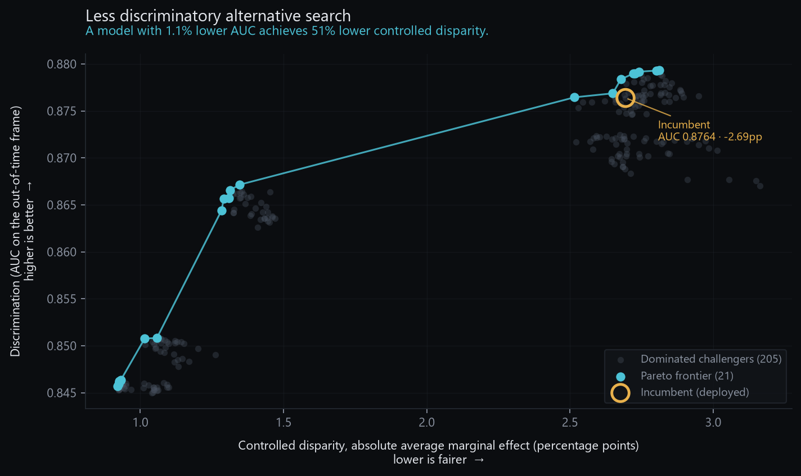

# Tallystick

**Lenders can build a credit model in a week, then spend six months getting it past model
risk and fair lending review. This is the second part, automated.**

A serving layer that wraps a credit model and makes four things automatic byproducts of
scoring an applicant, rather than four separate manual projects:

1. Every decision is reproducible and tamper-evident.
2. Every decline produces regulator-ready reason codes.
3. Fairness testing and less-discriminatory-alternative search run as code.
4. The model validation document generates itself from the artifacts.

```bash
uv run tally setup && uv run tally demo
```

> **Recording the demo GIF is the one thing left to do.** Everything it would show
> works — [`docs/demo_script.md`](docs/demo_script.md) is the sixty-second script,
> timed and rehearsed. Drop the GIF in here once recorded; it belongs above the fold.

---

## The name

A tally stick was the English Exchequer's instrument of record for six hundred years.
A debt was notched into a hazel rod, then the rod was **split lengthwise**: the
creditor kept the *stock*, the debtor kept the *foil*. To verify a claim you brought
the halves together. The grain of a split piece of hazel cannot be reproduced, and
neither half means anything alone.

That is a hash chain, built in 1110.

---

## The problem

Model documentation is written by hand months after the model was built, by someone
reconstructing decisions from memory. Fairness testing happens once, in a notebook, and
is never repeated. Decisions cannot be reproduced under examination because nobody
recorded which model version scored which applicant. Monitoring dashboards get built and
then nobody reads them.

None of that is a modelling problem. It is a systems problem, and it is the part that
takes six months.

---

## What the search found



> **A model with 1.1% lower AUC achieves 51% lower controlled disparity.**

That sentence is generated, not written. 226 challenger models were trained across
feature subsets, tree complexity, regularisation, and a fairness-penalised objective;
21 sit on the Pareto frontier of (discrimination ↑, measured disparity ↓). Under
disparate impact doctrine, a business-justified model is still challengeable if a
comparably effective, less discriminatory alternative exists. Nobody can answer that by
inspection — so this searches for one, and records the space it searched.

Selecting a frontier point produces the comparison a model risk committee actually
needs: at equal approval volume, adopting that challenger moves 722 applications in each
direction, with Hispanic applicants net **+228** (+3.6pp) and the controlled disparity
improving for every measured group.

---

## Architecture

```
                        ┌──────────────────────────────────────┐
   applicant ─────────► │  POST /api/score                     │
                        │                                      │
                        │  LightGBM (monotone constraints)     │
                        │        │                             │
                        │        ├─► SHAP, threshold-anchored ─┼─► reason codes
                        │        │                             │   counterfactual
                        │        └─► decision                  │
                        └────────────────┬─────────────────────┘
                                         │  every decision, no exceptions
                                         ▼
                        ┌──────────────────────────────────────┐
                        │  SQLite ledger  ·  append-only        │
                        │  triggers + SHA-256 hash chain        │
                        └────────────────┬─────────────────────┘
                                         │
        ┌────────────────────────────────┼────────────────────────────────┐
        ▼                                ▼                                ▼
  verify + replay              fairness engine                  validation pack
  chain from genesis           raw · controlled · proxy         12 sections, PDF
  re-score under the           on the out-of-time frame         every figure read
  pinned model version                   │                      from an artifact
                                         ▼
                              alternative search
                              226 challengers, Pareto frontier
```

One process, one port. The dashboard is served by the same FastAPI app that serves the
API — no build step, no npm, no CORS.

---

## What it does, feature by feature

### Decisions are reproducible and tamper-evident

Every decision is a row in an append-only SQLite ledger. Append-only is enforced by
database triggers, not by convention, and each row is chained to its predecessor by
SHA-256 over a canonical serialisation.

Paste a decision identifier and the service walks the chain from genesis, loads the
exact model version the decision was made with, and re-scores the stored application:

```
✓ Walk the hash chain from genesis      2,001 decisions, intact
✓ Load the pinned model version         v001 · hash matches
✓ Re-score the stored application       |stored − recomputed| = 0.0e+00
```

Corrections are new rows carrying `supersedes`, never edits. There is no update path and
no delete path anywhere in the codebase.

**Honestly:** the triggers stop accidents and the chain detects tampering, but neither
stops an adversary who can drop the triggers and recompute every subsequent hash. Making
the ledger tamper-*proof* needs an external witness, which is out of scope and
[stated as such](docs/limitations.md).

### Reason codes answer the question Regulation B actually asks

Explaining an application against the population mean answers *"why is this applicant
unusual"*. Regulation B asks what would have had to be different for approval — a
question about the decision boundary, so the reference has to be the boundary.

The naive implementation subtracts a constant from the SHAP base value and calls it a
threshold baseline; that relabels an offset without changing the attribution. This
instead builds the background from real applications sitting at the cutoff, selected so
their mean score *is* the threshold. Contributions then sum to the applicant's distance
from the decision boundary. The measured residual is 1.5e−2 log-odds against a naive
mean baseline of 2.91.

Counterfactuals are binary-searched — sound only because the model is monotone in the
searched feature — then **re-scored and verified** before disclosure, and never allowed
outside the range observed in training. Where no achievable value would flip the
decision, it says so rather than quoting a misleading number.

### Fairness testing runs as code

Three analyses on the out-of-time frame (51,038 applications from a year the model never
saw):

| | What it measures | Real result |
|---|---|---|
| **7a** Raw disparity | Approval rate per group, four-fifths screen | Hispanic ratio **0.770** — flagged |
| **7b** Controlled | Logistic regression on protected class + the model's own credit factors | Hispanic **−2.69pp**, p = 3.8e−22, n = 6,191 |
| **7c** Proxy scan | Normalised mutual information, features × protected attributes | `tract_minority_pct` ranks first at 45× the noise floor |

7b is the one that gets argued. A raw gap can be explained by differences in the
applications; a coefficient that survives the lender's own stated credit factors cannot.
Both the no-geography and county-fixed-effects specifications are reported, because
choosing one silently would be taking a side on a contested question.

The scan carries a **seeded random negative control** in every run, so the noise floor is
visible rather than assumed, and a **set-level** check that fits a model predicting group
membership from the feature set — the model's features predict applicant race and
ethnicity with macro-AUC **0.734**, which pairwise scanning cannot see.

The engine also fits the same specification on the *historical* lender decisions, which
separates disparity the model introduces from disparity already present in the behaviour
it learned. Here the model carries less residual disparity than its training labels, and
still a highly significant amount.

### The validation pack generates itself

`uv run tally pack` produces a **28-page PDF in under thirty seconds**. Zero hand-written content:
every figure is read from an artifact that some other command produced. Retrain and
regenerate, and the document describes the new model with no editing.

Twelve sections structured against the SR 11-7 validation pillars, with an appendix
cross-referencing each to EU AI Act Annex IV and ECOA. Sections 10 and 11 are pulled
verbatim from [`docs/limitations.md`](docs/limitations.md) and
[`docs/monitoring.md`](docs/monitoring.md), so what a reader sees is what the repository
maintains.

📄 **[Sample generated validation pack](docs/sample/validation_pack_sample.pdf)** — open it
without running anything.

A decline also produces a real **[adverse action notice](docs/sample/adverse_action_sample.pdf)**
built from the ledger row, carrying the ECOA notice verbatim and the specific principal
reasons. It explains that the FCRA disclosures are inapplicable — no consumer report was
used — rather than including boilerplate that does not apply.

### Portfolio review, not one application at a time

Upload a CSV, or sample one, and the whole book is scored, chained into the ledger as a
single batch with one receipt hash, and analysed by the same fairness engine. 2,000
applications score, chain, and verify in **13 seconds**.

The delicate part is that a batch file *must* carry protected attributes — fairness
cannot be measured without them — while those columns must never reach a feature vector.
The parser splits every row into a `RawApplicant` and an `ApplicantContext` at read time;
only the former can be passed to the model, and the ledger row stores only the former.

---

## The tool has been shown to catch something

A governance tool that has never caught anything is not a governance tool.
[`tests/fixtures/biased_model.py`](tests/fixtures/biased_model.py) builds a model with a
deliberate disparity — a synthetic feature correlated 0.9 with a protected attribute and
heavily weighted — alongside a clean model built the same way without it.

All three analyses flag the biased model. None fires on the clean one.

```bash
uv run pytest tests/test_fairness_adversarial.py -v
```

The clean model still shows set-level predictability above chance, because income and
loan-to-value genuinely differ by group. That is the honest baseline, and it is asserted
too.

---

## What this is not

- **Not a default-risk model.** The target is `action_taken` — what the lender did, not
  what the borrower did. It learns to replicate historical approval behaviour, including
  any bias in it. Every disparity reported here is a disparity in approval behaviour.
- **No credit score.** Public HMDA excludes the single most predictive variable in
  consumer underwriting. Performance figures are not comparable to a production model,
  and the importance of the variables that *are* present is inflated.
- **Coarsened inputs.** Debt-to-income arrives banded, and loan amounts are rounded to
  the nearest $10,000 midpoint, which puts a floor on how precisely any counterfactual
  can be quoted.
- **Clean metrics on a static dataset do not establish that a deployed system is
  compliant.** They establish properties of a model artifact.
- **The alternative search covers a bounded space.** Finding nothing better inside it is
  not proof that nothing exists. The space searched is recorded in
  `artifacts/lda/grid.json` so the claim can be checked.

Full list: [`docs/limitations.md`](docs/limitations.md).

---

## Access

The service serves three things on one port: a public landing page at `/` that
explains the system and lets a visitor score against the real model, a sign-in flow at
`/login`, and the dashboard at `/app`.

Evaluators can click **open the demo** and get a scoped guest session with no signup.
Each click provisions its own account rather than a shared login, so guest activity
stays attributable and any one session can be revoked without affecting the others.

```bash
uv run tally user create you@example.com --role admin   # prompts for a password
uv run tally user list
uv run tally user role someone@example.com analyst
```

Auth was originally out of scope, and was built for one reason: the override endpoint
used to take the actor's name from the request body, which made the audit trail a
claim rather than a record. The actor is now the authenticated user, read from the
session, and `OverrideRequest` has no field to put one in.

Passwords are argon2id. Session cookies carry an opaque token whose SHA-256 is what
the database stores, so a read of the sessions table yields nothing usable.
[`docs/security.md`](docs/security.md) sets out what is implemented and — at greater
length — what is not.

---

## Quickstart

Requires Python 3.11 and [uv](https://docs.astral.sh/uv/).

```bash
git clone <this repo> && cd tallystick
uv run tally setup
uv run tally all --quick
uv run tally demo
```

`setup` installs dependencies and the Chromium build used for PDF rendering. `all
--quick` builds every artifact from nothing — download, train, evaluate, fairness,
drift, and a reduced 40-challenger search — in **about two and a half minutes**. Drop
`--quick` for the full 226-challenger grid, which adds roughly eight minutes and is
resumable. `demo` serves the dashboard at `http://127.0.0.1:8787` and builds anything
still missing.

On Windows, `.\make.ps1 <target>` works too. GNU `make` is supported where present, but
`uv run tally` is the canonical entry point.

<details>
<summary>All commands</summary>

| Command | What it does |
|---|---|
| `tally doctor` | Environment preflight |
| `tally data` | Download HMDA and build the modelling frames |
| `tally train` | Train and register a model version |
| `tally evaluate` | Performance, segments, calibration |
| `tally fairness` | The three fair lending analyses |
| `tally lda [--quick]` | Search for a less discriminatory alternative |
| `tally drift` | PSI and KS against the out-of-time vintage |
| `tally pack` | Generate the validation pack PDF |
| `tally adverse-action <id>` | Generate an adverse action notice |
| `tally batch-demo [--n]` | Score a sampled portfolio |
| `tally verify-ledger` | Walk the hash chain from genesis |
| `tally user create/list/role/passwd/disable` | Manage accounts |
| `tally demo` | Serve the landing page, sign-in, and dashboard |
| `tally test` | Run the suite (203 tests) |

</details>

A rehearsed walkthrough, including the questions this tends to provoke, is in
[`docs/demo_script.md`](docs/demo_script.md).

---

## Deploying

The marketing page is static and belongs on a CDN. The service needs a persistent
disk and exactly one writer, because the ledger is a single-writer SQLite database
and the hash chain assumes a single appender — which also rules out serverless
entirely, along with 792 MB of dependencies against a 250 MB limit.

```bash
fly deploy                                    # the service, with a volume at /data
vercel --prod                                 # the landing page
```

Full walkthrough, including why the split exists and what to check before it is
public: [`docs/deployment.md`](docs/deployment.md).

---

## Data

FFIEC HMDA Loan/Application Register, public modified data. Colorado, trained on 2024
with **2025 held out entirely** as an out-of-time frame.

HMDA carries no date field beyond the activity year, so an intra-year temporal split is
impossible; using the following vintage is the only construction that yields a genuine
out-of-time frame, and it doubles as the drift comparison. The cost is that the newest
vintage is not used for training — a deliberate trade in favour of stability evidence.

Two traps in the public data, both handled explicitly in
[`src/tally/data/schema.py`](src/tally/data/schema.py):

- The Data Browser API and the Snapshot file use **different column names for the same
  column** — `loan_to_value_ratio` versus `combined_loan_to_value_ratio`. A
  dash-to-underscore normalisation does not fix it.
- The API **silently drops unknown query parameters**. Sending a filter that does not
  exist returns unfiltered data that looks correct. The download client uses a whitelist
  that raises, then asserts on the row counts it actually received.

---

## A finding worth writing down

**LightGBM does not honour monotone constraints for rows routed through a missing-value
split**, and the failure is not confined to the feature that is missing. Verified on
synthetic data with a `+1` constraint on feature 0:

| Setup | Violations |
|---|---|
| Clean training, clean prediction | 0 |
| NaN in an **unconstrained** feature, training only | 0 |
| NaN in an **unconstrained** feature, training and prediction | **44** |
| NaN in an unconstrained feature, prediction only | 0 |

Any feature carrying NaN at training time creates missing-bin splits, and a row routed
through one escapes constraint enforcement on the *constrained* features too. So a model
can claim constraints it does not honour — which would also invalidate the counterfactual
binary search, since binary search is only sound on a monotone function.

Every feature is therefore imputed at its training median before fitting (under 1%
missingness throughout), training raises if any feature arrives incomplete, and
`tests/test_model_monotonicity.py` sweeps each constrained feature across its range on
500 real applications to check the property empirically rather than trusting the
parameter.

---

## Regulatory grounding

Pointers, not quotations, and not a claim of compliance. See
[`docs/regulatory_mapping.md`](docs/regulatory_mapping.md).

- **ECOA / Regulation B** §1002.9 — adverse action notices must state the specific
  principal reasons. Model complexity does not excuse generic ones. → reason codes,
  counterfactuals, notices
- **SR 11-7 / OCC 2011-12** — model risk management: conceptual soundness, ongoing
  monitoring, outcomes analysis. → the pack's section structure
- **EU AI Act** — Annex III 5(b) classifies creditworthiness assessment as high-risk;
  Article 11 and Annex IV set documentation content, Article 12 logging, Article 14 human
  oversight. Standalone Annex III obligations were deferred to **2 December 2027** by the
  Digital Omnibus. That moved the deadline, not the workload: conformity assessment on a
  high-risk system runs closer to a year than a quarter.
- **FCRA** — where a consumer report informs the decision, further disclosures attach.
  None is used here, which the notice says explicitly.

---

## Stack

Python 3.11 · uv · DuckDB · LightGBM · SHAP · statsmodels · FastAPI · SQLite ·
Jinja2 → Chromium print-to-PDF · vanilla JS

DuckDB queries the HMDA CSVs directly with no server. LightGBM is chosen for
`monotone_constraints`. statsmodels is used because the fairness analysis needs p-values
and confidence intervals, not point estimates. PDF rendering goes through headless
Chromium rather than WeasyPrint, which needs GTK native libraries that break one-command
setup on Windows.
